<div align="center">

<picture>
  <source media="(prefers-color-scheme: dark)" srcset=".github/assets/banner-dark.svg">
  
</picture>

**Store subscriptions with typed entitlements and verified lifecycle events.**<br>
Query products, purchase, restore and acknowledge through StoreKit 2 and Google Play Billing.

[](https://packagist.org/packages/pushinbr/pam-native-subscriptions)
[](https://github.com/push-in/pam-native-subscriptions/releases/latest)

[](https://github.com/push-in/pam-native-subscriptions/actions/workflows/ci.yml)
[](LICENSE)

[Install](#install) · [Load and purchase](#quick-example) · [Platforms](#platform-support) · [Production](#production-rules) · [Docs](#docs) · [Issues](https://github.com/push-in/pam-native-subscriptions/issues)

</div>

<a id="install"></a>
## <picture></picture> Install

Inside a PAM Native project, add only this capability:

```sh
pam composer require pushinbr/pam-native-subscriptions
pam doctor --fix
```

New to PAM? Create a project with `pam init my-app --template native` (see the [PAM Native overview](https://push-in.github.io/pam-docs/native/overview/)), then come back here. Composer owns the manifest and the lockfile; `pam composer` runs it on PAM's verified PHP runtime.

<a id="quick-example"></a>
## <picture></picture> Load and purchase

```php
<?php

declare(strict_types=1);

use Pam\Native\Subscriptions\Subscriptions;

$subscriptions = new Subscriptions();
$subscriptions->products(['pro.monthly'], function (array $products) use ($subscriptions): void {
    $product = $products[0] ?? null;
    if ($product === null) {
        return;
    }

    $subscriptions->purchase(
        $product->identifier,
        fn ($transaction) => sendToYourBackend($transaction->verification),
        $product->offerToken,
    );
});
```

The purchase result distinguishes purchased, pending, cancelled and failed states through `SubscriptionPurchaseState`. Use `restore()` during account recovery and after sign-in on a new device, and `acknowledge()` for Google Play purchases after your server verified them.

Never grant durable entitlement from the device callback alone. Send `verification` (a signed JWS on iOS, a Play purchase token on Android) to your backend, validate it with the App Store Server API or Google Play Developer API, persist the entitlement, then acknowledge Google Play purchases.

<a id="platform-support"></a>
## <picture></picture> Platform support

| Platform | Support | Notes |
| --- | --- | --- |
| Android | API 26+ | Google Play Billing 9.1.0 |
| iOS | 15.0+ | StoreKit 2 |
| PAM Native | 0.8.0 to < 2.0.0 | From `pam-native.plugin.json`; PHP 8.5+ |

<a id="requirements"></a>
## <picture></picture> Requirements

The plugin declares no Android permissions and no iOS usage descriptions. Configure matching product identifiers in App Store Connect and Google Play Console before querying the catalog, and run a server that verifies transactions with Apple or Google.

Platform SDKs, credentials, entitlements, physical hardware and store configuration remain application responsibilities.

<a id="what-you-can-build"></a>
## <picture></picture> What you can build

- Premium plans and feature entitlements
- Trials, upgrades and restores
- Subscription-aware offline access

| | |
| --- | --- |
| **Native path** | Google Play Billing · StoreKit 2 |
| **Application model** | Composer package + generated native integration |
| **Design rule** | Independent module; no feed, vertical or application template bundled |

<a id="api-guide"></a>
## <picture></picture> API guide

| API | Responsibility |
| --- | --- |
| `Subscriptions` | Load products, purchase, restore, and acknowledge. |
| `SubscriptionProduct` | Read normalized product, price, and offer metadata. |
| `SubscriptionTransaction` | Receive store verification material. |
| `SubscriptionPurchaseState` | Handle purchased, pending, cancelled, and failed states. |

All coded states, kinds, and variants are sequential integer-backed enums. Use enum cases in application code; do not depend on raw wire numbers.

<a id="production-rules"></a>
## <picture></picture> Production rules

- Verify every transaction with Apple or Google on your server.
- Persist entitlement server-side and reconcile it at sign-in.
- Acknowledge Google Play only after successful server verification.
- Run `pam doctor`, `pam test`, and a signed release build on every supported platform.
- Exercise denial, cancellation, backgrounding, process restart, and offline behavior before release.

Security vulnerabilities should be reported through the repository security policy or GitHub private vulnerability reporting, not a public issue.

<a id="troubleshooting"></a>
## <picture></picture> Troubleshooting

- **Products are empty:** verify identifiers, store availability, agreements, and test account.
- **Purchase remains pending:** preserve state and wait for store resolution.
- **Restore finds nothing:** verify the signed-in store account and server entitlement mapping.
- **Native integration is stale:** run `pam doctor --fix`, rebuild the native host, and inspect the first reported diagnostic.

<a id="docs"></a>
## <picture></picture> Docs

- [PAM Native overview](https://push-in.github.io/pam-docs/native/overview/)
- [Plugin and native capability model](https://push-in.github.io/pam-docs/native/plugins/)
- [PAM introduction](https://push-in.github.io/pam-docs/introduction/)
- [Changelog](CHANGELOG.md)
- [Report an issue](https://github.com/push-in/pam-native-subscriptions/issues)

<a id="pam-ecosystem"></a>
## <picture></picture> Part of the PAM ecosystem

<p align="center"><picture>
  <source media="(prefers-color-scheme: dark)" srcset=".github/assets/pam-wordmark-dark.svg">
  
</picture></p>

PAM runs PHP natively on servers, desktops and phones. This repository is one piece of it.

| [**PAM**](https://github.com/push-in/pam) | [**PAM Desktop**](https://github.com/push-in/pam-desktop) | [**PAM Native**](https://github.com/push-in/pam-native) | [**Ecosystem**](https://github.com/push-in/pam#ecosystem) |
| --- | --- | --- | --- |
| the runtime and CLI | native desktop apps in PHP | native Android and iOS apps in PHP | every official package and plugin |

<sub>Docs: [push-in.github.io/pam-docs](https://push-in.github.io/pam-docs/introduction/) · [Issues](https://github.com/push-in/pam-native-subscriptions/issues)</sub>

<p align="center"><sub><a href="LICENSE">Apache License 2.0</a> · Made in Brazil by Pushin</sub></p>
